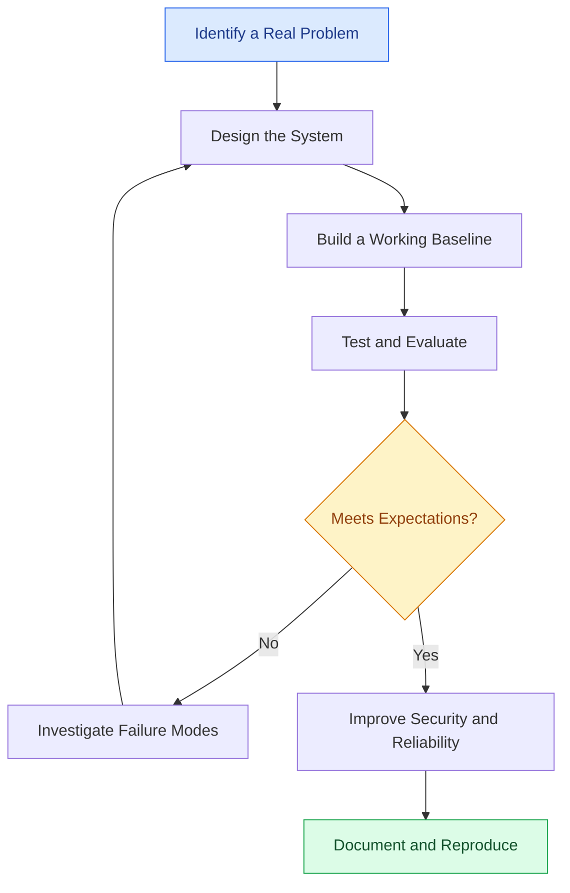

# Sarvesh Nand

### Aspiring AI Engineer

**LLM Applications · RAG · AI Agents · Evaluation · LLMOps**

Backend-trained and systems-minded. I'm learning to build AI applications that go beyond generating text: applications that retrieve knowledge, use tools, handle failures, and can be tested and operated reliably.

 

---

## 👋 About Me

I'm a BCA graduate from Uttar Pradesh, India, with a foundation in Python, Java, SQL, and backend development. I'm working toward a career in AI engineering, focusing on LLM-powered applications and reliable AI systems.

I'm interested in what it takes to build useful AI applications beyond a basic model API call:

- Designing prompts and generating structured outputs
- Retrieving relevant information and managing context
- Connecting models to tools and building controlled workflows
- Evaluating outputs, investigating failures, and improving reliability
- Deploying and monitoring applications with sound engineering practices

My approach is hands-on: build reproducible projects, test assumptions, investigate failures, document trade-offs, and share what I learn. I'm also exploring Linux, Docker, CI/CD, and monitoring as foundations for deploying and operating AI applications reliably.

> **My goal:** Become an AI engineer who can build, evaluate, secure, and deploy practical AI applications, not just prototype them.

---

## 🧠 Areas I'm Exploring

<table>
  <tr>
    <td width="50%" valign="top">

**LLM Fundamentals & Application Development**
- LLM APIs, capabilities, limitations, and trade-offs
- Prompt engineering and structured outputs
- API integration, orchestration, and error handling
- Conversation history and context management

</td>
    <td width="50%" valign="top">

**RAG & Knowledge Systems**
- Document ingestion, parsing, and chunking
- Embeddings, vector search, and retrieval strategies
- Retrieval-Augmented Generation (RAG)
- Source attribution and retrieval quality evaluation

</td>
  </tr>
  <tr>
    <td width="50%" valign="top">

**AI Agents & Context Engineering**
- Tool calling and multi-step workflows
- Agent state, memory, and context management
- Deterministic workflows vs. autonomous agents
- Human approval, guardrails, and failure handling

</td>
    <td width="50%" valign="top">

**Evaluation, Security & AI Systems**
- Test datasets and LLM evaluation
- Hallucination analysis and regression testing
- Prompt injection and data protection
- Latency, token usage, and cost optimization
- Tracing, observability, deployment, and LLMOps

</td>
  </tr>
</table>

---

## 🔧 Technical Skills

**Programming & Backend Foundations**

**Infrastructure & Deployment Foundations**

**AI Engineering Learning Path**

`LLM APIs` · `Prompt Engineering` · `RAG` · `Embeddings` · `Vector Search` · `Tool Calling` · `AI Agents` · `Context Engineering` · `LLM Evaluation` · `AI Security` · `LLMOps`

> **Transparency matters.** I distinguish between technologies I've used, technologies I'm actively learning, and concepts I plan to explore. Listing a technology or topic does not imply production experience.

---

## 🚀 AI Engineering Projects

I'm working toward projects that demonstrate software engineering fundamentals alongside practical AI engineering.

| Project | What It Will Demonstrate | Status |
|---|---|---|
| **LLM Application API** | API integration, structured outputs, validation, retries, and error handling | 📅 Planned |
| **RAG Knowledge Assistant** | Document ingestion, chunking, embeddings, retrieval, and grounded answers | 📅 Planned |
| **Tool-Using AI Agent** | Tool calling, controlled workflows, state management, and failure handling | 📅 Planned |
| **LLM Evaluation Framework** | Test datasets, quality metrics, failure analysis, and regression testing | 📅 Planned |
| **Production-Ready AI Application** | Docker, CI/CD, tracing, evaluation, security checks, and cost monitoring | 📅 Planned |

As projects become functional, I'll link their repositories here and document the architecture, setup instructions, design decisions, evaluation results, known limitations, and lessons learned.

> **Project principle:** A working demo is only the beginning. I want to understand why a system works, where it fails, and how to measure whether an improvement actually helps.

---

## 🏗️ How I Approach Engineering

**For AI applications**, this means looking beyond the model's answer and examining:

- Retrieval quality and context relevance
- Tool behavior and output validation
- Latency, token usage, and cost
- Security risks and failure modes

**For deployment**, it means applying the same habits I value in backend and infrastructure work: reproducibility, automation, observability, and careful handling of secrets.

---

## 🛡️ Engineering Principles

| Principle | What It Means |
|---|---|
| **Understand before abstracting** | Learn the underlying behavior before relying on a framework or agent abstraction. |
| **Measure before optimizing** | Use repeatable tests and evaluation datasets instead of judging AI quality from a few impressive examples. |
| **Design for failure** | Models can produce incorrect outputs, tools can fail, and retrieval can miss relevant information. |
| **Security is part of the design** | Consider prompt injection, sensitive data, tool permissions, and untrusted inputs from the beginning. |
| **Keep systems reproducible** | Document setup, configuration, dependencies, and experiments so others can reproduce the results. |
| **Use AI, verify AI** | AI tools can accelerate development, but generated code and outputs still need testing and review. |
| **Document trade-offs** | Explain why a solution was chosen, what alternatives exist, and where the solution falls short. |

---

## 📚 Learning Roadmap

My current roadmap, from programming foundations to production-oriented AI engineering:

- [x] Complete foundational BCA studies
- [x] Gain initial exposure to backend development with Python, Java, and SQL
- [ ] Strengthen Python, testing, data structures, and software design
- [ ] Understand LLM fundamentals and model APIs
- [ ] Build LLM applications with structured outputs and orchestration
- [ ] Develop a RAG system and evaluate retrieval quality
- [ ] Build controlled, tool-using AI workflows
- [ ] Learn context engineering and agent design
- [ ] Develop repeatable LLM evaluation and regression tests
- [ ] Study AI security and common LLM application vulnerabilities
- [ ] Deploy an AI application with Docker and CI/CD
- [ ] Add tracing, observability, cost tracking, and continuous evaluation
- [ ] Explore AI system design and production LLMOps

> Progress reflects foundational education and initial exposure, not mastery or production-level expertise. I'll update the roadmap as I gain practical experience.

---

## 🎯 Opportunities

I'm interested in entry-level opportunities that let me grow as a software engineer working on AI-powered products and systems:

- Junior AI Engineer
- Generative AI Engineer
- LLM Application Engineer
- Python Developer (AI Applications)
- AI Engineering Intern
- Junior AI Platform / LLMOps Engineer, as my practical experience develops

📍 **Location:** India &nbsp;·&nbsp; 🌎 **Open to suitable remote opportunities**

I'm particularly interested in teams that value strong engineering fundamentals, hands-on learning, testing, thoughtful system design, and continuous improvement.

---

## 🎓 Education

**Bachelor of Computer Applications (BCA)**
Veer Bahadur Singh Purvanchal University · 2023–2026

---

## 📫 Let's Connect

I'm building my path into AI engineering one project at a time. If you're working on LLM applications, RAG, AI agents, evaluation, or AI infrastructure, I'd be glad to connect, learn, and exchange ideas.

 

**Build. Evaluate. Understand. Improve. Repeat.**

